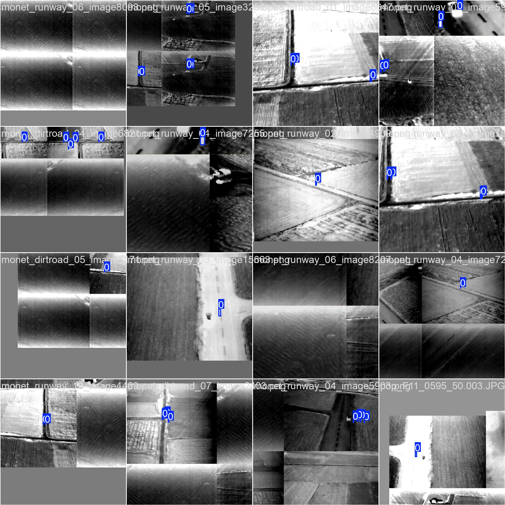

# UAV Thermal Person Detector

**Person detection in thermal drone imagery for search and rescue (SAR)** in rural environments: runways, dirt roads and open fields.

[](LICENSE)


YOLOv8-based models trained on a custom thermal dataset (with some RGB frames), labeled with a single class: `person`. The goal is a **screening aid for a human operator** watching a drone feed, not an autonomous decision system.

---

## Highlights

- Two variants: a **fast model** for limited drone or embedded hardware, and a **high-recall model** with an extra P2 head for people seen as a few pixels from altitude.
- Trained on **real thermal footage** with typical sensor artefacts (horizontal banding, vignetting).
- Ready to run with the `ultralytics` package: one command for images, folders or a live camera.

## Models

| Model | Architecture | Params | imgsz | Precision | Recall | mAP50 | mAP50-95 |
|---|---|---|---|---|---|---|---|
| `best_uav_fast.pt` | YOLOv8s | 9.8M | 512 | 0.822 | 0.607 | 0.693 | 0.424 |
| `monet_pop_p2_1024` (best epoch) | YOLOv8m-**p2** | 25.1M | 960 | 0.889 | 0.713 | – | 0.502 |

- **`best_uav_fast`**: lightweight, built for fast inference (~76 ms/frame on CPU at 512 px). A good starting point for limited hardware.
- **`monet_pop_p2_1024`** (see [`notebooks/train_p2_1024.ipynb`](notebooks/train_p2_1024.ipynb)): adds a **P2** detection head (stride 4) aimed at very small objects, since a person seen from altitude often covers only a few pixels. Trained at 960 px, it gets better recall and mAP50-95 at a higher compute cost. *Its weights are not included in this repository; only the training notebook and metrics are.*

Only `best_uav_fast.pt` is included under [`models/`](models/), because of size.

## Dataset

- Real thermal drone imagery (FLIR-style sensor noise: horizontal banding, vignetting), plus a few RGB frames.
- Organised by capture scenario: runways (`runway`), dirt roads (`dirtroad`) and others.
- Single class, `person`. Most boxes are very small (people seen from altitude), which makes recall the hardest metric to improve.
- Training batch samples (mosaic augmentation) in [`samples/`](samples/):

  

## Quick start

```bash
pip install ultralytics

# Inference on an image or folder
yolo predict model=models/best_uav_fast.pt source=path/to/image_or_folder conf=0.25

# Live inference from a webcam or camera
yolo predict model=models/best_uav_fast.pt source=0 show=True
```

From Python:

```python
from ultralytics import YOLO

model = YOLO("models/best_uav_fast.pt")
results = model.predict("path/to/image.jpg", conf=0.25)
results[0].show()
```

## Training

[`notebooks/train_p2_1024.ipynb`](notebooks/train_p2_1024.ipynb) contains the full pipeline for the YOLOv8m-p2 variant on Google Colab: Drive mounting, dataset extraction, `yolo train` with `imgsz=960` and `cos_lr`, resuming after session interruptions, and per-epoch metric analysis.

## Limitations and responsible use

- mAP50-95 (~0.42–0.50) means box localisation is not perfect, although detection itself (mAP50) is reasonable.
- The fast model's recall (0.61) means it **misses people fairly often**. Use it to support a human operator, never as the only means of finding someone.
- The dataset has few boxes per image and many person-free backgrounds (hard negatives), as is typical in real SAR footage where the positive class is rare.

---

## Author

Built by **Jaime Salvador Moreno Villar** at **[Stellaris Code](https://www.stellariscode.com)**, where I work on software engineering for companies: recovering and migrating legacy applications, system integrations and applied AI.

Working on computer vision or need help with an old system nobody dares to touch? [Get in touch](https://www.stellariscode.com/diagnostico).

## License

[MIT](LICENSE)
